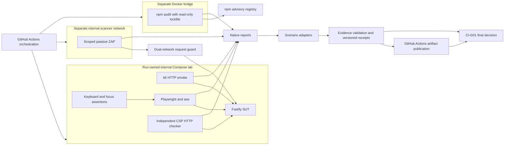

# Quality Engineering Lab

Quality Engineering Lab is a controlled QA/SDET project that demonstrates how to detect regressions, preserve native test evidence, and make a CI decision from that evidence. The system under test is a small TypeScript/Fastify app with Catalogue and Search pages, read-only JSON endpoints, and fixed synthetic data. Its size makes it possible to isolate one change at a time and observe its effect through independent HTTP and browser checks.

## Architecture

The checks live outside the SUT. Compose gives each test profile its own internal network with no published SUT ports. The defect switches affect only the app. The oracles use the same assertions in baseline, injected and recovery runs.



ZAP can reach the SUT only through the guard, which enforces the fixed origin and bounded GET allowlist. npm audit uses its own bridge execution with advisory access. [Scanner implementation](security/Invoke-SecurityChecks.ps1) · [Compose configuration](docker-compose.yml)

## Quality gates

PR means a pull request targeting `main`. Main means a push to `main`. [Scenario manifest](ci/manifest.json) · [GitHub Actions workflow](.github/workflows/quality.yml)

| Policy | Observable contract and tool | PR / main | Native evidence and limit |
| --- | --- | --- | --- |
| PERF-G01 | k6 checks HTTP 200, JSON and both expected notebook IDs. | Required / Required | k6 summary and log. Functional smoke only. |
| PERF-G02 | k6 calibration collects p50, p95, rates and errors under a fixed workload. | Optional / Optional. Hosted `NOT_RUN`. | Local k6 summary and sample stream. Comparison `INCONCLUSIVE`; no approved numerical threshold. |
| A11Y-G01 | Playwright checks rendered states and the accessible name. axe flags serious and critical violations. | Required / Required | Playwright and per-state axe JSON. Tested pages and Chromium only. |
| A11Y-G02 | Playwright checks tab order, visible focus and keyboard search submission. | Required / Required | Playwright JSON and keyboard observations. Selected keyboard path. |
| SEC-G01 | Independent HTTP checker verifies CSP and `nosniff`. Scoped passive ZAP checks pages reached through the guard. | CSP required on both. ZAP absent on PR (`NOT_RUN`), required on main. | HTTP observations, ZAP reports and guard logs. Narrow passive coverage. |
| DEP-G01 | npm audit checks the lockfile against advisory data. | Required / Required | Audit JSON and invocation. Advisory data can change. |
| CI-G01 | Validates scenario provenance and receipts, checks scoped cleanup, and requires hosted artifact publication. | Required / Required | Native bundle, receipts and publication outcome. Applies to the tested revision. |

## Verified evidence

Hosted run **45060111440**, attempt **1**, passed CI-G01 and all six required main scenarios at commit `a18f6d6517235f5a89e8717f11ceb94165e51913`. The native archive was retrieved and inspected on **2026-11-22**. The evidence index records its retention and separates the hosted baseline from the local experiments. [Actions run](https://github.com/Yeromenko-Kateryna/quality-engineering-lab/actions/runs/45060111440) · [Evidence index](evidence/README.md)

Final QEL-7 hosted acceptance is pending publication and verification of the documentation revision.

- **Accessibility.** Removing the search label caused Playwright's accessible-name assertion and axe rule `label` to fail. A fresh recovery restored `Search catalogue`. [Case](docs/cases/controlled-regressions.md#accessibility)
- **CSP.** Omitting CSP on five HTML states produced an independent HTTP policy failure. Status, media type and `nosniff` were preserved, and recovery restored the exact header. [Case](docs/cases/controlled-regressions.md#csp)
- **ZAP remediation.** Rule `10021` identified a missing `X-Content-Type-Options` header. A committed Fastify hook added `nosniff`, and passive reverification cleared the finding on the examined pages. [Case](docs/cases/controlled-regressions.md#historical-zap-rule-10021-remediation)
- **Performance eligibility.** Three local baselines completed with 150 successful measurements each. p95 ranged from 2.870 to 3.091 ms on the unqualified local host. [Calibration record](docs/cases/performance-calibration.md#observed-baseline)

## Quickstart

Use a fresh **PowerShell 7.4+** session with Git, Docker running a Linux engine, and Docker Compose with `up --wait`. The build needs access to the base image and lockfile dependencies. This path runs only the notebook smoke.

```powershell
git clone https://github.com/Yeromenko-Kateryna/quality-engineering-lab.git
Set-Location quality-engineering-lab
pwsh --version
docker info --format '{{.OSType}}'
docker compose version
```

Confirm that Docker reports `linux`. From the repository root, run this block in the same PowerShell session.

```powershell
$ErrorActionPreference = 'Stop'
$PSNativeCommandUseErrorActionPreference = $true
$project = "qel2-$([guid]::NewGuid().ToString('N'))"
$k6Image = 'ghcr.io/grafana/k6:2.3.0@sha256:2dd4756ec6e14e62778916e1eb850108e4b499304c02df56760fa0bdb0fba0b8'
$label = "label=com.docker.compose.project=$project"

function Get-LabResources {
    docker ps -a --filter $label --format 'container:{{.Names}}'
    docker network ls --filter $label --format 'network:{{.Name}}'
}

$existingTag = docker image ls --filter "reference=${project}-sut:latest" -q
if ((Get-LabResources) -or $existingTag) { throw "Compose identity is in use: $project" }

$env:LAB_DELAY_MS = '0'
$env:LAB_A11Y_DEFECT = 'false'
$env:LAB_SECURITY_DEFECT = 'false'
try {
    docker pull $k6Image
    docker compose -f docker-compose.yml -p $project build sut
    docker compose -f docker-compose.yml -p $project up --no-build --pull never --wait --wait-timeout 20 sut
    & ./performance/Invoke-SearchSmoke.ps1 -Project $project -Query notebook
    if ($LASTEXITCODE -ne 0) { throw "Smoke wrapper exit: $LASTEXITCODE" }
} finally {
    $expected = "container:$project-sut-1", "network:${project}_lab"
    if (Get-LabResources | Where-Object { $_ -cnotin $expected }) {
        throw "Unexpected project resources. Inspect ownership before teardown: $project"
    }
    docker compose -f docker-compose.yml -p $project down
    if (Get-LabResources) { throw "Owned containers or networks remain: $project" }
}
Get-Content "logs/$project/notebook-*/result.json" -Raw
```

Expect `PASS` and native k6 exit `0`. The run directory also keeps `summary.json`, `k6.log` and `invocation.json`. Teardown leaves the reports and shared build images available. Your generated `logs/` are local-only.

## Scope and further reading

The lab uses synthetic data and isolated test workloads. The evidence covers the tested Chromium pages and keyboard path, a scoped passive security baseline, and a bounded local latency experiment. WCAG conformance, penetration testing, production capacity and a calibrated latency gate are outside that evidence.

- [Local checks and troubleshooting](docs/local-checks.md)
- [Evidence index and retention](evidence/README.md)
- [Project brief and delivery status](PROJECT_BRIEF.md)
- [Portfolio definition of done](docs/portfolio-dod.md)
