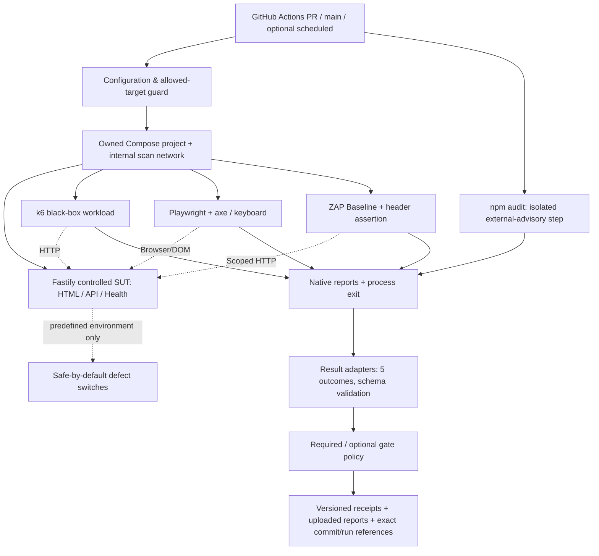

# Quality Engineering Lab — Architecture & Implementation Plan v0.2

**Дата:** 2026-11-22  
**Статус:** `PROPOSED — DELTA REVIEW REQUIRED`  
**Основание:** v0.1 и Independent Architecture Review (ATAM-lite), verdict `ACCEPT WITH CHANGES`.  
**Цель:** Junior QA Automation / Junior SDET portfolio, Germany / DACH / remote EU.  
**Правило доказательности:** это проектные контракты, **не** исполненные тесты, не подтверждённые CI runs и не измеренные performance baselines.

## 1. Executive decision и архитектурная миссия

**Решение v0.2:** сохранить небольшое контролируемое TypeScript/Fastify SUT и независимые k6, Playwright + axe-core, OWASP ZAP Baseline и npm audit. Добавить пять **контрактных** уточнений: независимые test oracles, сопоставимые performance measurements, enforceable isolation, пятизначную модель результатов и минимальный provenance contract. Не добавлять новых сервисов.

**One-sentence mission:** *A reproducible non-functional quality engineering lab that detects performance, accessibility and security regressions in a controlled web application through measurable checks, CI quality gates and traceable reports.*

**Портфельная граница:** ReqGuard показывает system/integration testing (UI → API → PostgreSQL → CI) и детерминированные AI Quality mechanics; QEL показывает **новые** performance, accessibility, general-security baseline и их quality decisions. Повторные CRUD, SQL assertions, большой UI regression framework и AI eval не входят в QEL.

**Архитектурный стиль:** modular test harness in a single repository; один SUT и независимо исполняемые тестовые слои. Нет микросервисной архитектуры или собственной платформы мониторинга.

## 2. Входные допущения, проверяемые факты и границы

- **FACT (source-bound):** независимый аудит v0.1 принял выбор SUT и инструментов, но потребовал пять обязательных контрактных исправлений; статус по итогам аудита — `ARCHITECTURE_READY = NO` до их delta-проверки.
- **FACT (source-bound):** переданный handoff ReqGuard описывает ограниченно подтверждённые hosted runs, но не подтверждает performance/load capacity, WCAG conformance или general DAST coverage.
- **ASSUMPTION:** GitHub Actions и Docker Compose доступны, но конкретные версии инструментов/образов и поведение контейнерной сети требуют проверки при реализации.
- **ASSUMPTION:** безопасность и воспроизводимость проще обеспечить полностью disposable SUT со статическими синтетическими данными, чем полноценным сторонним приложением.
- **UNKNOWN:** фактическая скорость SUT, шум CI runners, точные latency thresholds и фактические findings scanners; эти значения нельзя проставлять до исполнения.
- **RECOMMENDATION:** после delta acceptance немедленно перейти к одному работающему SUT vertical, а не создавать ещё один большой design report.

## 3. SUT contract и ограничения scope

**Target:** маленькое приложение Fastify/TypeScript с фиксированным dataset, HTML Catalogue, HTML Search, JSON `GET /api/items`, `GET /api/search`, `GET /health`. Минимальные состояния поиска: найдено, пустой результат, невалидный ввод с понятным feedback. Health не раскрывает секреты и не служит измеряемой бизнес-операцией.

**Зависимости:** Node.js, пакетный lockfile, Docker image с pinned version/digest к моменту реализации. Никаких БД, аккаунтов, реальных пользовательских данных, публичных API или cloud deployments. Основной SUT не является deliberately vulnerable production clone.

**Контролируемые переключатели:** `LAB_DELAY_MS`, `LAB_A11Y_DEFECT`, `LAB_SECURITY_DEFECT`. Только переменные окружения SUT, заданные **до** старта контейнера, валидируемые при запуске. Значения безопасны по умолчанию (`0`/`false`), никаких публичных endpoints для изменения switches. Невалидные значения → отказ запуска с диагностикой, не silent fallback. `LAB_DELAY_MS` ограничен безопасным для CI максимальным значением; предел закрепляется после пилота и не допускает бесконечного ожидания.

**Измеряемый контракт:** `/api/search` возвращает один и тот же результат для одинакового запроса и dataset как при `LAB_DELAY_MS=0`, так и при положительной задержке; переключатель влияет на публично наблюдаемую latency, а не на payload. Для a11y переключатель изменяет доступное имя конкретного search input в DOM. Для security переключатель удаляет применимый к HTML-страницам заголовок `Content-Security-Policy` (CSP); safe baseline содержит строго заданную, совместимую с HTML implementation политику. CSP должен быть проверен по реально выдаваемому response; не использовать HSTS как gate на plain HTTP.

## 4. CHANGE-01 — Независимые regression oracles (P0)

**Критический инвариант:** test runners не читают `LAB_*` и не знают об их ожидаемых значениях. Test expectations определяются только публичным HTTP/DOM поведением и заранее утверждённой **одинаковой** policy. Test harness или отдельный orchestration step может задавать test profile, но не менять assertions, thresholds и result parser в зависимости от профиля.

| Scenario | Что меняет switch внутри SUT | Независимый observable oracle | Evidence (baseline → injected → recovery) |
|---|---|---|---|
| PERF-04 | `LAB_DELAY_MS` добавляет серверную задержку к `/api/search` | k6 измеряет `http_req_duration`, проверяет response, сравнивает с утверждённой latency policy | Нормальный p95 в пределах policy → превышение p95/FAIL → снова PASS, при квалифицированной среде |
| A11Y-04 | `LAB_A11Y_DEFECT` убирает доступное имя input | axe на rendered DOM обнаруживает relevant label/name violation; Playwright не читает switch | 0 соответствующих violations → violation/FAIL → 0 после восстановления |
| SEC-05 | `LAB_SECURITY_DEFECT` удаляет применимую CSP с HTML response | Независимый HTTP assertion проверяет заголовок против требуемой policy; ZAP — дополнительный пассивный report | Header присутствует/PASS → отсутствует/FAIL → снова присутствует/PASS |

**Значение доказательства:** RED/ GREEN не засчитывается, если тест утверждает лишь значение `LAB_*`, если expectation переключается между режимами, либо если отсутствует подтверждение наблюдаемого изменения HTTP/DOM.

**Design acceptance:** для всех трёх сценариев назван наблюдаемый дефект, неизменный oracle и безопасное восстановление. **Runtime acceptance (позже):** реальные source tests и триадные evidence receipts по одному и тому же policy ID.

## 5. CHANGE-02 — Performance measurement contract (P0)

### 5.1 Профили и неизменяемые параметры

| Profile | Роль | Первичная настройка (proposal, не измерение) | Gate |
|---|---|---|---|
| `smoke` | Проверка работоспособности | 1 VU × 10 секунд, HTTP + content checks | Нулевая доля проверенных errors, все required checks PASS |
| `baseline` | Измерение latency | 5 VUs × 30 секунд, фиксированный сценарий поиска | p50/p95, errors, actual request rate; latency gate после калибровки |
| `regression` | Проверка чувствительности | **Та же конфигурация** что baseline, но изменён только switch задержки | Превышение прежнего утверждённого latency threshold должно определяться независимо |
| `extended` (P1) | Дополнительная оценка | 10 VUs × 60 секунд | Диагностика, пока не квалифицирован runner |

Baseline и regression должны сохранять одинаковые `SUT commit/image digest`, dataset hash, route/query, VUs, duration, pacing/think time, requests, connection settings, k6 version, warmed state, timeout policy и runner class. **Единственное намеренное различие — latency switch.** Для сравнения двух разных коммитов это отдельный regression-review contract с явным указанием изменённой версии, не смешивать с controlled defect case.

**Warm-up:** заданный предварительный прогрев измеряемого endpoint; не включается в окно статистики. Данные неизменяемы между прогонами. Один сценарий — один измеряемый endpoint; healthcheck не включать в latency distributions.

**Closed workload caveat:** фиксированные VUs образуют closed model; при росте latency фактическая request rate может уменьшаться. Throughput выводится как diagnostic, не независимый CI pass gate. Следует фиксировать таймауты и частоту ошибок: успешные быстрые ответы и timeouts не должны бездумно объединяться в среднее, скрывая degradation.

### 5.2 Калибровка и утверждение policy

1. Зафиксировать environment fingerprint и выполнить **не менее 3 независимых** baseline runs; 5 — если доступно без лишних затрат.
2. Оценить p50/p95, ошибки, run-to-run dispersion, фактическое число запросов и вытекающую статистическую ограниченность p95. Если объём/стабильность недостаточны, классифицировать сравнение `INCONCLUSIVE`.
3. Предложить threshold как **инженерный performance budget** на основании измеренного распределения, вариативности и цели обнаружить meaningful injected delay. Сохранить baseline sample IDs, decision rationale, дату, SUT digest и policy version.
4. Утвердить policy отдельно от получения тестового результата: нельзя подбирать threshold *после* injected run ради гарантированного FAIL. Для демонстрации выбрать задержку, существенно превышающую наблюдаемый noise, но в пределах безопасного максимума.
5. Пересматривать threshold при изменениях workload, SUT, dataset, runner class или значимом изменении шумовых характеристик. Не переносить числовые значения между неэквивалентными средами без перекалибровки.

**Два разных CI механизма:** `PERF-G01` — required smoke проверяет HTTP errors/content и корректность k6 execution на shared runner. `PERF-G02` — latency regression comparison активируется как required только после квалификации окружения и утверждения numerical policy. До этого p95 сохраняется как diagnostic; результат сравнения `INCONCLUSIVE`, а не PASS. Для controlled delay допустим required demonstration, только если подтверждена чувствительность и сравнимость условий.

**Порядок сравнения:** baseline и injected запускать **последовательно в изолированных SUT instances** с одинаковыми ресурсами, без параллельных workload jobs, фиксировать order и fingerprint. Не утверждать production-capacity claims даже после успешных локальных сравнений.

**Design acceptance:** contract допускает однозначно определить eligible/ineligible comparison, separation smoke/benchmark, процедуру calibration, unapproved threshold и noisy `INCONCLUSIVE`. **Runtime acceptance позже:** documented baseline receipt и утверждённый численный policy, не искусственно придуманный заранее.

## 6. CHANGE-03 — Security, target и resource isolation (P0)

### 6.1 Разрешённая цель и сеть

**Default scan target:** единственный контейнер SUT, например `http://sut:3000`, по внутреннему Docker DNS. Runner контейнеры k6/ZAP/Playwright должны использовать **internal Docker network** (`internal: true`), выделенную конкретному Compose project. `http://localhost:3000` может быть разрешён только для отдельного локального host-browser профиля с явной привязкой порта `127.0.0.1:...`, но не как свободно выбираемая целевая строка для security scanner.

**Hard target guard перед любым scanner/load runner:** разрешить только протокол `http:`, точный host `sut`, port `3000`, предопределённый base path; отклонить redirects на чужой origin, userinfo, IP-literal, произвольные ports, внешние домены и пользовательскую подстановку полного URL. Проверять конечное назначение запросов; не считать DNS/URL-проверку единственной изоляцией. Любая внешняя ссылка, обнаруженная spider, не должна приводить к сетевому запросу вне разрешённого origin. При попытке — stop/diagnostic, не расширять allowlist автоматически.

**Physical/network guard:** сеть `internal: true` запрещает обычный внешний маршрут для runner/SUT network. Не подключать ZAP к default/outbound Docker network; не использовать `network_mode: host`; не публиковать ZAP наружу. Запрет внешней сети относится к runtime-scan jobs; `npm audit` требует registry advisory API и выполняется **отдельным** CI step с ограниченными правами и без участия этой сети. Docker image acquisition/build выполняется до запуска замкнутой scan environment. Ограничение: детали enforcement нужно проверить на фактически используемом Docker runner.

**ZAP Baseline:** только authorized controlled SUT; passive findings после ограниченного crawling. Поскольку spider формирует HTTP requests, сервер должен быть read-only для этих маршрутов, а scan ограничен по времени/числу запросов/допустимым путям. Никаких active scans, exploit modes или произвольных third-party targets в MVP.

### 6.2 Resource ownership и teardown

- Каждый workflow/run/profile получает уникальное безопасное `COMPOSE_PROJECT_NAME` на основе GitHub run ID, attempt и purpose; все ресурсы имеют соответствующую метку/namespace. Не использовать один shared compose project для параллельных baseline/injected runs.
- Только созданные этим запуском контейнеры, networks и временные output dirs удаляются через `docker compose -p "$PROJECT" down --remove-orphans` (без `--volumes`, если shared ownership не доказан; named volumes по умолчанию отсутствуют). Запрещены общесистемные `docker system prune` и удаление ресурсов по широкому префиксу.
- У каждого job/profile собственная директория артефактов, deterministic fixture set и временные имена. Baseline завершает teardown **до** создания injected профиля. Parallel CI runs должны быть изолированы namespace/runner; cancellation обрабатывается cleanup step `always()` при возможности, с остаточным риском hard kill.
- Не передавать secrets в SUT, scan requests и artifacts; GitHub job permissions по умолчанию `contents: read`. Недоверенные pull requests не получают write credentials.

**Design acceptance:** invalid target отклоняется **до** сетевого сканирования; запрещённый redirect не сканируется; параллельные profiles не разделяют mutable SUT/resources; cleanup не затрагивает ресурсы другого run. **Runtime acceptance позже:** negative config tests + два параллельных profile runs + проверка resource labels после teardown.

## 7. CHANGE-04 — CI result semantics (P0)

Пять состояний — **внутренние** результаты каждого scenario/gate, не нативные GitHub Actions conclusions.

| Outcome | Значение | Required gate effect | Diagnostics |
|---|---|---|---|
| `PASS` | Инструмент завершился, валидный report присутствует, policy соблюдена | Green | policy, метрики, evidence refs |
| `FAIL` | Валидное выполнение и подтверждённое нарушение policy | Red | failed assertion, threshold/finding |
| `TOOL_ERROR` | Crash, timeout scan execution, malformed/unreadable report, readiness failure, неуспешная обязательная публикация | Red (не считать дефектом SUT) | process exit, stderr, phase, missing artifact |
| `INCONCLUSIVE` | Данные получены, но quality decision не квалифицировано (например noise/неутверждённый latency threshold) | Red для required decision; допускается как явно non-blocking diagnostic | причина/условия квалификации |
| `NOT_RUN` | Проверка пропущена, отменена или не была запрошена | Red для mandatory; допустима для заранее объявленной optional | documented skip/cancellation reason |

**Tool adapter contract:** сохранять нативные process exit code + stdout/stderr excerpt + report presence/schema/scan completion marker. Exit 0 **сам по себе** не означает PASS: требуется валидный содержательный report и утверждённая policy. Nonzero exit тоже неоднозначен: при корректном report с violated threshold → `FAIL`; при crash/невозможности получить достоверный report → `TOOL_ERROR`. Для ZAP коды завершения классифицировать только по зафиксированной версии и официально проверенной семантике, с явным parsing of findings; не назначать FAIL на основе одного необработанного exit number.

**Aggregation rules:** один обязательный `FAIL` → overall quality `FAIL`; если `FAIL` отсутствует, но есть обязательный `TOOL_ERROR` → `TOOL_ERROR`; затем обязательный `INCONCLUSIVE`, затем обязательный `NOT_RUN`; полный `PASS` допустим **только** когда все required checks `PASS`, а все required artifacts валидны и опубликованы. Optional checks не должны превращать overall PASS в «они тоже прошли»: перечислить отдельные outcomes; optional scan с `TOOL_ERROR` виден и не считается verified coverage. Если required job отменён — workflow не должен трактоваться как successful quality acceptance.

**Negative contract fixtures (test of summarizer):** missing report; empty report; incompatible schema; tool crashes after creating partial file; timeout; scan with high finding; inconclusive noisy run; deliberate skip; report from different commit; artifact upload failure. Для каждого запрограммирована ожидаемая classification; **не использовать** `continue-on-error` так, чтобы required gate завершался зелёным без отдельного blocking decision step.

**Design acceptance:** определено поведение всех пяти states, distinction product failure vs tool failure, required/optional, native exit → outcome и невозможность missing-report PASS. **Runtime acceptance позже:** adapter/summarizer unit tests на failure fixtures.

## 8. CHANGE-05 — Evidence provenance и artifacts (P0)

### 8.1 Versioned per-scenario summary

Каждый required executed scenario создаёт **минимальный** структурированный receipt. Схема ниже — пример формата, значения в ней **placeholder, не реальные результаты**:

```json
{
  "schema_version": "1",
  "commit_sha": "<actual full commit SHA>",
  "run_id": "<actual CI run ID or local UUID>",
  "run_attempt": "<actual attempt>",
  "environment": {
    "runner_class": "<hosted-ubuntu-or-controlled-local>",
    "sut_image_digest": "<actual digest>",
    "dataset_hash": "<actual hash>",
    "tool_version": "<actual tool version>"
  },
  "quality_dimension": "performance",
  "scenario_id": "PERF-02",
  "policy_id": "PERF-G02",
  "policy_version": "<approved policy revision>",
  "outcome": "INCONCLUSIVE",
  "reason": "<reason threshold not yet approved>",
  "artifact_paths": ["<existing native report path>"],
  "measured_at_utc": "<actual timestamp>"
}
```

**Обязательные инварианты:** `commit_sha`, `run_id`, `scenario_id`, `policy_id`, `outcome` и referenced native artifact нужны для verified execution claim; `environment` достаточен для квалификации результата (для performance дополнительно фиксировать profile, VUs, duration, warm-up, request count, checks, thresholds и measurement conditions). SHA не подменяется последним HEAD при агрегации старых отчетов. `run_id` локального запуска никогда не выдаётся за GitHub Actions ID. Нативный отчет не перезаписывается суммарным summary.

### 8.2 Validation и publication boundary

1. Инструмент исполняется и сохраняет native report в owned directory.
2. Adapter валидирует execution completion, report format/content и outcome, формирует per-scenario receipt.
3. Summarizer принимает только receipts валидной schema version и согласованного run/commit/policy context; missing/duplicate/inconsistent receipts делают required result `TOOL_ERROR`, не PASS.
4. CI загружает raw reports и summary независимо от PASS/FAIL; upload mandatory artifacts — required job step. Ошибка обязательной публикации блокирует employer-evidence acceptance, даже если сами tests были зелёными.
5. README связывает **реально существующие** run URLs/commit SHAs и небольшие стабильные итоговые summaries. Истёкшая artifact URL помечается как недоступная: исторический recorded outcome не переписывается в FAIL, но claim о независимо доступном полном отчёте прекращается.

**Не сохранять:** реальные данные пользователей, токены, полные секретные headers, неограниченные network traces. Reports с только синтетическими данными; ссылки на PR и реальные actions добавляются после фактических прогонов.

**Design acceptance:** один receipt однозначно связывает actual revision/run, environment, scenario/policy, outcome и существующий native artifact; missing/corrupt report/upload failure не может дать employer-facing PASS. **Runtime acceptance позже:** schema tests + artifact upload proof для exact SHA.

## 9. Обновлённая логическая архитектура



**Interpretation:** defect switches конфигурируют **только SUT**, а не тестовые expectations. `Config & allowed-target guard` отказывает до network activity. Test layers независимы; aggregated result следует валидируемому contract. `npm audit` не подключается к закрытой scan сети. Последняя пунктирная связь показывает конфигурационную границу SUT, а не runtime API управления дефектами.

## 10. Quality strategy и policy IDs (без вымышленных baseline)

| Dimension | Required MVP check | Gate | Claim boundary |
|---|---|---|---|
| Performance | Smoke HTTP/content, error policy, execution report | `PERF-G01` | Работоспособность smoke, **не** production throughput |
| Performance | p95 baseline + controlled delay with qualified policy | `PERF-G02` после calibration | Regression при квалифицированных одинаковых условиях |
| Accessibility | axe on Catalogue/Search/Results + keyboard/focus | `A11Y-G01/G02` | Automated + selected manual checks, **не** WCAG 2.2 AA conformance |
| Security | CSP independent header assertion + passive ZAP and finding triage | `SEC-G01` | Narrow security baseline, **не** pentest/certification |
| Dependencies | Known advisory scan and disposition | `DEP-G01` | Known dependencies at scan date, **не** software safety proof |
| CI | All mandatory receipts and linked native evidence | `CI-G01` | Version-bound execution, **не** production release |

Accessibility checks отдельно фиксируют input accessible name, keyboard submission, focus order/visibility, feedback state. Умеренные и minor findings сохраняются и triage, не игнорируются автоматически. Security high findings блокируют только по утверждённой policy/triage; ложноположительные и accepted risks должны быть адресными и документированными.

## 11. Минимальная организация репозитория и CI

```text
quality-engineering-lab/
├─ PROJECT_BRIEF.md
├─ AGENTS.md
├─ README.md
├─ docker-compose.yml
├─ sut/                      # Fastify, templates, fixture data, Dockerfile
├─ performance/              # k6 smoke + workload + profile metadata
├─ accessibility/            # Playwright / axe / keyboard
├─ security/                 # ZAP scoped rules + header assertions
├─ scripts/                  # target-guard, minimal adapters/summarizer, readiness
├─ docs/
│  ├─ architecture.md
│  ├─ quality-gates.md
│  ├─ test-strategy.md
│  ├─ decisions/              # only material ADRs
│  └─ triage/
├─ evidence/                  # stable index/summaries, not oversized generated logs
└─ .github/workflows/        # PR/main; scheduled optional
```

**PR:** lint/typecheck, SUT startup/health, k6 smoke, axe critical pages, CSP assertion, dependency policy (если registry доступен), schema tests для receipt; быстрый отзыв. **Main:** расширенная проверка, calibrated performance comparison если квалифицирован, ZAP baseline, all required reports. **Scheduled:** optional only if recurring finding is useful. Количество workflow файлов не принципиально. Проверки могут сохранять native report даже при non-PASS, но required gate остаётся блокирующим.

**Documentation budget:** короткий `AGENTS.md` — навигация; один `PROJECT_BRIEF.md`; один ADR по SUT selection до implementation; performance measurement ADR и security scope ADR — короткие, по мере соответствующих gates. Не создавать лишние матрицы и абстрактные фреймворки.

## 12. MVP / P1 / P2 / non-goals

- **MVP:** controlled SUT, safe switches, black-box k6/axe/header checks, scoped passive ZAP, npm audit, isolated Compose runs, required status/evidence contract, at least one verified RED→fix→GREEN, readable README and limitations.
- **P1:** qualified repeated baseline with robust comparison, richer keyboard audit, historical trends/stable summaries, more detailed triage.
- **P2:** separate deliberately vulnerable security target, targeted active security scenarios under authorization, optional SBOM or advanced workload model — only if market/interview ROI is established.
- **Explicit non-goals:** production deployment, Kubernetes/Terraform, DB, login/user management, cloud-scale capacity benchmarking, unrestricted public scanning, penetration-testing certification, own dashboard, large Playwright E2E regression suite, LLM eval platform.

## 13. Roadmap и gate dependencies

| Gate | Objective | Acceptance checks | Expected evidence | Dependencies | Indicative effort |
|---|---|---|---|---|---|
| QEL-0 | Contract/architecture baseline v0.2 | Delta review of CHANGE-01..05; scope accepted | Review verdict, docs diff | None | 2–4 h |
| QEL-1 | Small runnable SUT | Fresh Compose setup, target-guard plan, health, synthetic routes, isolated cleanup | Local/CI commands, HTTP checks | QEL-0 | 5–8 h |
| QEL-2 | First performance vertical | k6 smoke; native result; correct errors; no invented p95 budget | Reports + exact revision | QEL-1 | 7–11 h |
| QEL-3 | A11y vertical | axe + keyboard; missing-label failure independent of flag | Red/green reports | QEL-1 | 6–10 h |
| QEL-4 | Security vertical | allowed-target guard, CSP assertion, ZAP passive triage | Negative scope test + ZAP report | QEL-1 | 7–11 h |
| QEL-5 | CI and evidence | five-outcome mapping, mandatory receipts, upload / cleanup | Exact SHA + Actions run | QEL-2/3/4 | 6–10 h |
| QEL-6 | Controlled regression proof | Same-policy baseline→injected FAIL→recovery; perf eligibility enforced | Diagnosed case study | QEL-5 | 6–10 h |
| QEL-7 | Employer-facing close | Independent reproducibility, honest reports, Portfolio DoD | README evidence index | QEL-6 | 4–7 h |

**Effort range:** 43–71 h as rough planning heuristic from v0.1; not a verified or guaranteed duration. QEL-2/3/4 may be implemented separately once QEL-1 is green. If complexity increases, reduce optional depth instead of expanding infrastructure.

## 14. Change traceability: mandatory independent-review findings

| Change | v0.2 section | Architectural contract | Inspectable design acceptance | Later executable proof |
|---|---|---|---|---|
| `CHANGE-01` | §3–4 | Switch affects only SUT; invariant black-box oracle | Three observable cases, no test flag dependency | Each baseline/FAIL/recovery triple |
| `CHANGE-02` | §5, §10 | Fixed workload, calibration and qualification | Comparison eligibility & inconclusive criteria | k6 receipt + calibrated policy |
| `CHANGE-03` | §6, §9 | Local-only allowlist, internal network, ownership | Forbidden target rejected; teardown scoped | Negative target + parallel ownership checks |
| `CHANGE-04` | §7 | Five explicit outcomes and precedence | Missing/invalid/optional mappings specified | Failure-fixture tests for adapters |
| `CHANGE-05` | §8, §9 | Versioned per-scenario provenance + raw reports | Exact SHA/run/scenario/policy binding and upload fail policy | Valid receipt + uploaded report URL |

**Изменения за пределами этого набора:** новых обязательных архитектурных изменений не предлагается.

## 15. Remaining architecture blockers и decision points

**Относительно пяти findings в рамках проекта:** все пять теперь представлены design-level contracts; **принятие исправлений независимым reviewer пока не подтверждено**. Поэтому текущий статус — `ARCHITECTURE_READY = PENDING_DELTA_REVIEW`, а не `YES`.

**Операционные неизвестные, не блокирующие design review, но блокирующие соответствующие runtime claims:**

1. Реальная корректность `internal: true` + target guard на выбранном CI runner; проверить negative network test до ZAP.
2. Выбор и проверка конкретного CSP для выбранных шаблонов Fastify, включая совместимость с HTML resources.
3. Пиннинг инструментов, версии adapters и фактическая семантика exit codes ZAP/k6.
4. Количественный latency threshold — утверждается только после baseline calibration; отсутствие threshold не разрешает заявлять успешный performance regression benchmark.
5. Нативные отчёты, ссылки GitHub Actions и artifact retention существуют только после реального запуска.

Эти вопросы должны решаться в соответствующих implementation gates, а не путём нового архитектурного расширения. Если delta reviewer обнаружит настоящую логическую противоречивость одной из пяти поправок, исправлять **только затронутый контракт**.

## 16. Immediate next action и остановка проектирования

**Следующее действие:** передать этот v0.2 независимому reviewer для **delta-only check CHANGE-01..CHANGE-05**, с результатом `ACCEPT` или списком конкретных неснятых противоречий. **После ACCEPT:** QEL-0 зафиксировать, запустить Codex Brief QEL-1 — minimal Fastify SUT + disposable Compose + read-only catalogue/search/health + проверяемая изоляция. Никаких GitHub mutation и application code в рамках данного документа не выполнено.

**Portfolio DoD:** runnable SUT; проверенные test dimensions; ясно определённые gates; exact revision CI evidence; хотя бы один действительный RED→fix→GREEN; findings triage; limitations и независимая reproduction. **Это не Production/Release DoD.** После достижения Portfolio DoD — остановить разработку, отложить P1/P2.

---

### Delta-review brief для независимого архитектора

> Review only mandatory changes CHANGE-01 through CHANGE-05 against the original ATAM-lite findings. Verify independence of defect oracles, performance comparison eligibility, enforceable security/resource isolation, five-result CI semantics and versioned evidence provenance. Do not perform a full redesign. State `ARCHITECTURE_READY = YES/NO`, identify only unresolved material contradictions, and distinguish design acceptance from runtime verification.
